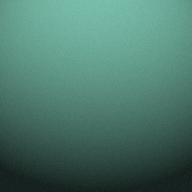
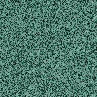

# render-vs-reference

[](https://github.com/real-adi1806/render-vs-reference/actions/workflows/tests.yml)
[](LICENSE)
[](pyproject.toml)

**Measure a render against a reference image without lying to yourself.** The
command it installs is called `pixel-truth`.

Pixel-diff tools tell you *that* two images differ. This tells you *how*, in
numbers you can act on. More importantly, it is built to stop the four specific
ways those numbers quietly come out wrong.

## Quick start

```bash
pip install git+https://github.com/real-adi1806/render-vs-reference
pixel-truth compare reference.png yours.png --isolate
```

Or run it without installing anything (needs [uv](https://docs.astral.sh/uv/)):

```bash
uvx --from git+https://github.com/real-adi1806/render-vs-reference pixel-truth compare reference.png yours.png --isolate
```

Needs only Pillow. Python 3.9 or later.

## A real example

Clone the repository to get the two example images, then measure them:

```bash
git clone https://github.com/real-adi1806/render-vs-reference
cd render-vs-reference
pip install .
python examples/make_examples.py
pixel-truth compare examples/lit.png examples/shuffled.png
```

The two example images contain **exactly the same pixel values**. `lit.png` is
a lit, curved surface; `shuffled.png` is those same pixels in a random order.

| `lit.png` | `shuffled.png` |
|---|---|
|  |  |

```
  reference n=36864   candidate n=36864

  field         reference  candidate     delta       x
  ----------------------------------------------------
  mean             109.81     109.81     +0.00    1.00
  p10               44.81      44.81     +0.00    1.00
  p50              117.57     117.57     +0.00    1.00
  p90              160.09     160.09     +0.00    1.00
  saturation        36.84      36.84     +0.00    1.00
  grain              2.00      40.31    +38.31   20.15
  form              40.16       0.92    -39.25    0.02
  ratio             20.08       0.02    -20.06    0.00
  dark_share         1.48       1.48     +0.00       -
```

Read that: every histogram statistic is identical, because the pixels are the
same. A tool that compares distributions would call these a perfect match. One
is an object and the other is static, and `ratio` says so with a single number:
20 for the shaded surface, 0.02 for the noise.

---

## Why this exists

It was extracted from a real project: rebuilding an interactive site against a
reference, where every "match" had to be defended with a number.

Four times, the numbers were confidently wrong. Not noisy: precise,
believable, and pointing at the wrong conclusion. One of
them produced a fix that made every metric worse.

Each one has the same shape: **you measured something other than the object.**

| # | The lie | What it cost |
|---|---|---|
| 1 | A fixed box on a moving object | Same element, same build, measured `86.4` and `157.9` |
| 2 | A threshold mask hides your own change | Built a fix; every number got worse; the sample had shrunk 12,554 → 11,034 |
| 3 | A magnified crop measures the upscaling | Grain read `1.07 vs 1.00`, a match. Native: `3.64 vs 2.50`, 46% off |
| 4 | Two scales wearing one name | `p90 105.0` quoted as CIE L\*, which caps at 100 |

**[docs/FAILURE-MODES.md](docs/FAILURE-MODES.md) is the real content of this
repo.** The code is the smaller half.

---

## What it measures

| | |
|---|---|
| `mean p10 p50 p90` | luma, **0-255**, named so you cannot confuse it with L\* |
| `dark_share` | fraction below a threshold you choose |
| `saturation` | median, 0-100 |
| `grain` | median absolute luma delta between adjacent pixels: *surface texture* |
| `form` | sd of 4×4 cell means: *variation across the object* |
| `ratio` | `form / grain` |

**`ratio` is the one worth knowing about.** A lit solid varies more *across
itself* than *between neighbouring pixels*, so its ratio is well above 1. Noise
painted on a silhouette goes the other way, well below 1. A histogram cannot tell those
apart (two images with identical distributions can be a shaded object and
static, as the example above shows), but this can, and it is a single number.

`form` and `grain` are in luma levels, so they shrink when the whole object gets
darker. A copy at 0.6x brightness reads about 0.6x on `mean` and on `form`. A
`form` gap points at the lighting only when it differs from the `mean` gap.

---

## Use it on your own images

Give it two images, the reference first and yours second. Any format Pillow can
open works.

```bash
# the main event: one instrument, both sides, same arguments
pixel-truth compare ref.png ours.png --isolate

# every pixel, no mask, no threshold. run this BEFORE concluding anything
# about tone, because a masked percentile can say the opposite
pixel-truth histogram ours.png

# small-feature density across four vertical columns
pixel-truth specks ref.png ours.png

# machine-readable for CI
pixel-truth compare ref.png ours.png --json
```

### `--isolate`

Finds the object, draws its outline, and measures the middle of the outline's
bounding box (a 25% inset), which drops the rim. The largest bright region says
where the object is. The outline is everything connected to it that differs
from the ground (the median of the frame's border), lighter or darker, by more
than the ground's own noise. So a darker copy of the same object gets the same
outline, and the same part of it is measured.

Use it whenever the thing you care about **moves, scales or travels**. A fixed
rectangle mixes object with background in a ratio that changes every frame, so
you are measuring an accidental blend. If no object is found, or its core is
under 20 pixels on a side, the command line stops with an error and measures
nothing, rather than measuring the background. If the ground is too uneven to
outline against (the outline would cover more than half the frame), it falls
back to the bright region alone and says so. That outline moves with
brightness, so crop both sides by hand if their brightness differs.

It looks for a bright object. On a dark object over a light page it finds the
page, so crop both images to the object yourself, by the same rule on both
sides.

---

## As a library

```python
from PIL import Image
from pixeltruth import isolate, core_box, measure, compare, histogram

ref  = Image.open("reference.png")
ours = Image.open("ours.png")

# isolate the subject on each side, then measure only that
mask = isolate(ours)
if mask:
    ours = ours.crop(core_box(mask))

print(measure(ours))
print(compare(ref, ours)["fields"]["p50"])
print(histogram(ours))          # unmasked, every pixel
```

`measure()` returns a `Stats` dataclass. **`Stats.n` is the sample size and it
is not decoration.** If `n` changes between runs of the same instrument, the
sample changed and your statistics are not comparable. `compare()` sets
`sample_warning` when the two sides differ by more than 25%.

---

## The rule

> **One instrument, both sides, same arguments, native resolution, sample size
> printed.**

Everything here enforces some part of that. `compare()` runs identical code over
both images. `_same_scale()` **downscales** the larger side and never upscales
the smaller. `measure()` always reports `n`. `luma()` says which scale it is in
its own docstring.

---

## Tests

The tests are written as the failure modes. Modes 1 and 3 are rebuilt as tests
that construct the situation and assert the right answer; modes 2 and 4 are
covered by property checks (an unmasked histogram sees the dark pixels, `luma()`
is 0 to 255). One test asserts that a **fixed box still gets it wrong**, so the
fixture cannot silently stop demonstrating the bug. Another makes the
sample-size warning fire. Command-line tests check that `--isolate` refuses to
measure a frame with no object or an object too small to inset, and says so
when the ground is too uneven to outline against. A lit sphere at 0.6x
brightness, bigger and elsewhere in the frame, must read 0.6x (within 0.02 on
`mean`, 0.03 on `form`), and its outline must match the bright copy's on two
grounds, one lighter and one darker than its shadow side.

```bash
pip install ".[dev]" && pytest -q
```

A test that only checked "the function returns a number" would have passed
throughout every incident described here.

---

## What this is not

- **Not a pixel-diff.** It will not tell you which pixels changed. Use
  `odiff` or `pixelmatch` for that.
- **Not perceptual.** No SSIM, no CIEDE2000. It reports simple statistics with
  honest provenance, because the failures above were never about the
  sophistication of the metric.
- **Not a judge.** Numbers falsify; they do not verify. Three matching
  statistics out of twenty means nothing, and two images can match on every
  statistic here and still look nothing alike. **Look at the picture.**

That last point is the one I would keep if I could keep only one.

---

## Citing it

If you use it in research, GitHub's "Cite this repository" button (from
`CITATION.cff`) gives the citation.

## Contributing

Contributions are welcome, particularly new failure modes. If a measurement has
lied to you in a way not documented here, that is the most valuable thing you
could add: open an issue with the two images and the command you ran.

MIT licence.
